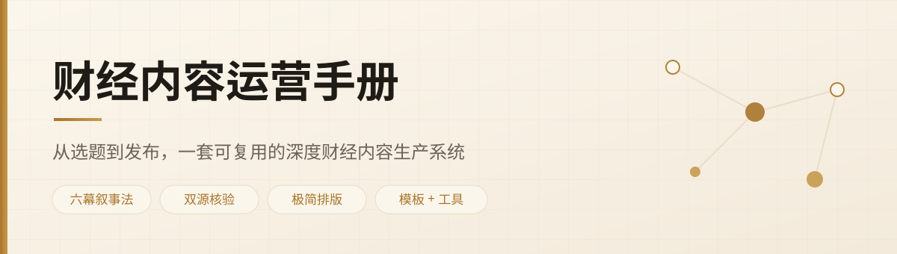

<div align="center">



# 财经内容运营手册

**从选题到发布，一套可复用的深度财经内容生产系统。**

一套在真实财经公众号里跑出来的方法论：六幕叙事法、双源事实核验、极简排版规范，
外加一整套开箱即用的模板、SOP 与零依赖图片工具。

[](LICENSE)
[](CHANGELOG.md)
[](tools/)
[](#)
[](CONTRIBUTING.md)

</div>

---

## 为什么会有这个项目

写财经内容，最难的从来不是"找到数据"，而是：

- 一堆信息摆在面前，**讲不出一条清楚的因果链** —— 读者读完不知道发生了什么；
- 数字似是而非，**转手就写错一个约数**，评论区被人挑错；
- 排版花里胡哨，色块、金句、设问堆一屏，**读者划走比读完快**；
- 每次从零开始，标题、封面、摘要、核查表**全靠临时拍脑袋**。

这套手册把上面每一个痛点，都沉淀成了**可复刻的规则 + 可直接复制的模板**。
它不谈"网感""爆款玄学"，只讲能被检视、能被传授、能被稳定复现的流程。

> 一句话：**把深度财经内容的生产，从手艺变成流程。**

---

## 核心内容

### 1. 六幕叙事法 —— 让文章像电影一样推进

不是信息拼盘，而是一个**完整事件**。动笔前先回答一句话："这件事的因果链是什么？"

| 幕 | 作用 | 硬性要求 |
|---|---|---|
| ① 开场 | 一个具体画面 | 有时间、有数字、有人，不用概念开头 |
| ② 点题 | 给读者地图 | 开头 200 字内点破"真正在改变什么" |
| ③ 起因 | 事情为何开始 | 只给支撑故事必需的信息 |
| ④ 推进 | 篇幅最大（40%+） | 分 3–4 步，每步回答"然后呢 / 所以呢" |
| ⑤ 高潮 | 最反常识的一刻 | 把张力收束到一个具体事实或数字 |
| ⑥ 结局 | 解开所有的结 | 影响、观察点、总结、首尾呼应、结论句 |

详见 [`docs/02-六幕叙事法.md`](docs/02-六幕叙事法.md)

### 2. 双源事实核验 —— 不确定就反复核到确定

每个关键数字至少两个独立来源，冲突取权威口径、无法判定整条删，约数绝不升级成确数。
每篇产出一张核查表：采用 / 降级表述 / 不采用（写明原因）三档分类。

详见 [`docs/03-事实核验SOP.md`](docs/03-事实核验SOP.md)

### 3. 极简排版规范 —— 少即是多，可被参数化

- 全文颜色固定 3 种（深褐 / 暗金 / 灰），不许出现第 7 个色值；
- 全篇最多 2 个色块：导读卡 + 结论句；
- 划重点极度克制：一屏最多 1 处加粗，全篇不超过 6 处；
- 全部内联样式，可直接粘贴进公众号编辑器。

详见 [`docs/04-极简排版规范.md`](docs/04-极简排版规范.md)

### 4. 标题 · 封面 · 配图 —— 一套可复用的视觉规则

- 标题公式：**一个反常识的转折 + 一个具体数字或时间**，≤22 字；
- 封面：标题定稿即出封面，标题改则封面重做；
- 配图：明亮、自然光、客观，图的作用是说明事实而不是渲染情绪；
- 附赠白字标题局部遮罩脚本，不把整图压暗。

详见 [`docs/05-标题封面与配图.md`](docs/05-标题封面与配图.md)

### 5. 全流程 SOP + 学习笔记法

一次成稿要交付 9 份产出物，从正文、排版 HTML、封面配图，到摘要、选题备忘、核查表、学习笔记、选题登记。
另有一套"教自己的笔记"规范：稿子里只放结论，笔记里放推导过程。

详见 [`docs/06-每日产出流程.md`](docs/06-每日产出流程.md) · [`docs/07-学习笔记法.md`](docs/07-学习笔记法.md)

---

## 仓库结构

```
wechat-content-playbook/
├── README.md                     # 你正在看的这份
├── LICENSE                       # CC BY-NC-SA 4.0 授权协议
├── CONTRIBUTING.md               # 贡献指南
├── CHANGELOG.md                  # 更新记录
├── docs/                         # 方法论正文（核心资产）
│   ├── 01-账号定位与DNA.md
│   ├── 02-六幕叙事法.md
│   ├── 03-事实核验SOP.md
│   ├── 04-极简排版规范.md
│   ├── 05-标题封面与配图.md
│   ├── 06-每日产出流程.md
│   └── 07-学习笔记法.md
├── templates/                    # 开箱即用的模板
│   ├── 账号DNA-模板.md
│   ├── 成稿-模板.md
│   ├── 事实核查表-模板.md
│   ├── 学习笔记-模板.md
│   ├── 摘要与标题-模板.md
│   ├── 选题备忘-模板.md
│   ├── 选题登记-模板.csv
│   └── 排版骨架.html
├── tools/                        # 零依赖图片工具
│   ├── png_crop.py               # 纯标准库 PNG 裁剪 + 缩放（去 AI 水印）
│   ├── scrim.py                  # 白字标题局部羽化遮罩
│   └── README.md                 # 工具用法
├── examples/                     # 完整示例
│   ├── 成稿示例-英伟达财报.md      # 六幕叙事范文
│   └── 事实核查表示例.md
└── assets/                       # 静态资源
    └── banner.svg
```

---

## 快速开始

```bash
# 1. 克隆仓库
git clone https://github.com/duanlinhao89-hash/wechat-content-playbook.git
cd wechat-content-playbook

# 2. 从模板起步：先定账号 DNA，再写第一篇
cp templates/账号DNA-模板.md my-account-dna.md
cp templates/成稿-模板.md my-first-article.md

# 3. 每篇都配一张核查表和学习笔记
cp templates/事实核查表-模板.md my-fact-check.md
cp templates/学习笔记-模板.md my-study-note.md

# 4. 处理封面图（可选，纯 Python 标准库，无需安装依赖）
python tools/png_crop.py 原图.png 封面.png 63 0 1410 600 --resize 900
```

然后按 [`docs/06-每日产出流程.md`](docs/06-每日产出流程.md) 的清单逐项交付即可。

---

## 这套方法适合谁

- 财经、商业、科技领域的**内容创作者**与公众号主理人；
- 需要稳定产出**深度长文**的自媒体作者与分析师；
- 想把"写作"这件事**流程化、团队化、可交接**的内容团队；
- 想学习如何把复杂事件讲清楚的**任何人**。

如果你写的不是财经，六幕叙事、事实核验、极简排版这三条同样适用 —— 把领域词换掉即可。

---

## 设计原则

1. **可复现**：每一步都有规则，不靠灵感和天赋。
2. **可检视**：数字带来源和时点，判断落在事实与机制上。
3. **克制**：排版、配色、重点标注都宁少勿多。
4. **零依赖**：工具脚本只用 Python 标准库，拿到就能跑。
5. **读者优先**：先要"读完有收获"，转发排第二。

---

## 贡献

欢迎补充案例、改进模板、翻译或指出方法论里的漏洞。请先读 [CONTRIBUTING.md](CONTRIBUTING.md)。
哪怕只是提一个 Issue 纠正一处规则，也是很有价值的贡献。

## 许可

本仓库内容采用 [CC BY-NC-SA 4.0](LICENSE) 授权：可署名、非商业、相同方式共享地自由使用与演绎。
`tools/` 下的代码脚本在此协议基础上额外允许自由用于个人与非商业项目。

---

<div align="center">

**如果这套手册帮你少走了一点弯路，给个 ⭐ Star 吧 —— 这是对方法论最好的投票。**

Made with care for people who care about clear writing.

</div>
